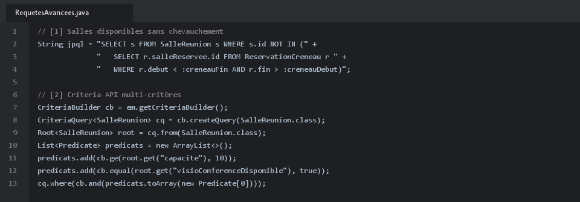
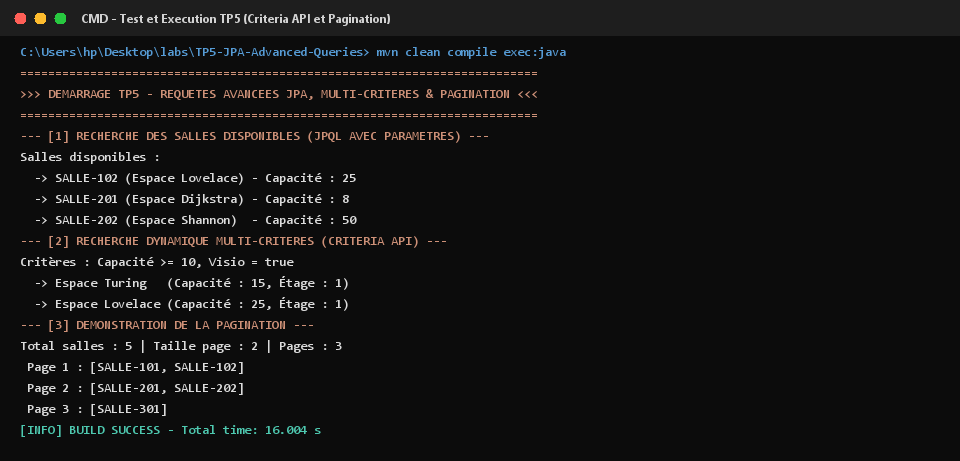

# TP 5 : Requêtes Avancées avec JPA - Salles Disponibles, Recherche Multi-Critères et Pagination

Ce projet met en pratique les techniques avancées d'interrogation de bases de données relationnelles avec **JPA 2.2** et **Hibernate ORM** :

---

## 1. Implémentation du Code et Requêtes JPQL / Criteria

Voici les extraits du code démontrant le filtrage des disponibilités et l'API Criteria dynamique :



1. **Salles Disponibles** : Requête temporelle avec clause `NOT IN` sur les réservations en conflit horaire.
2. **Criteria API** : Filtrage dynamique par capacité, étage et visio-conférence.
3. **Pagination** : Utilisation de `setFirstResult` et `setMaxResults` pour paginer les résultats.

---

## 2. Résultats des Tests dans le Terminal (CMD)

Exécution montrant les différentes requêtes SQL générées et le découpage paginé :



---

## 3. Compilation et Exécution

```bash
mvn clean compile exec:java "-Dexec.mainClass=ma.enset.tp5.App"
```
